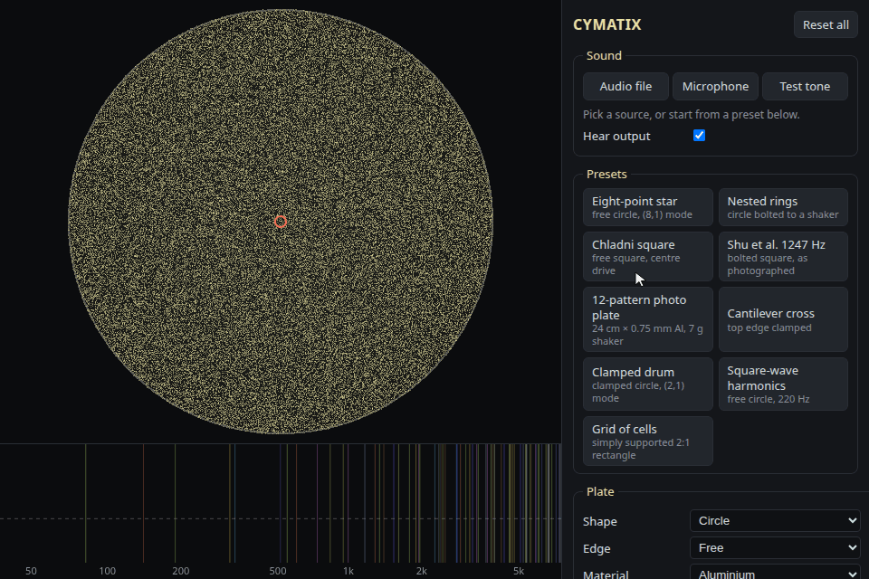
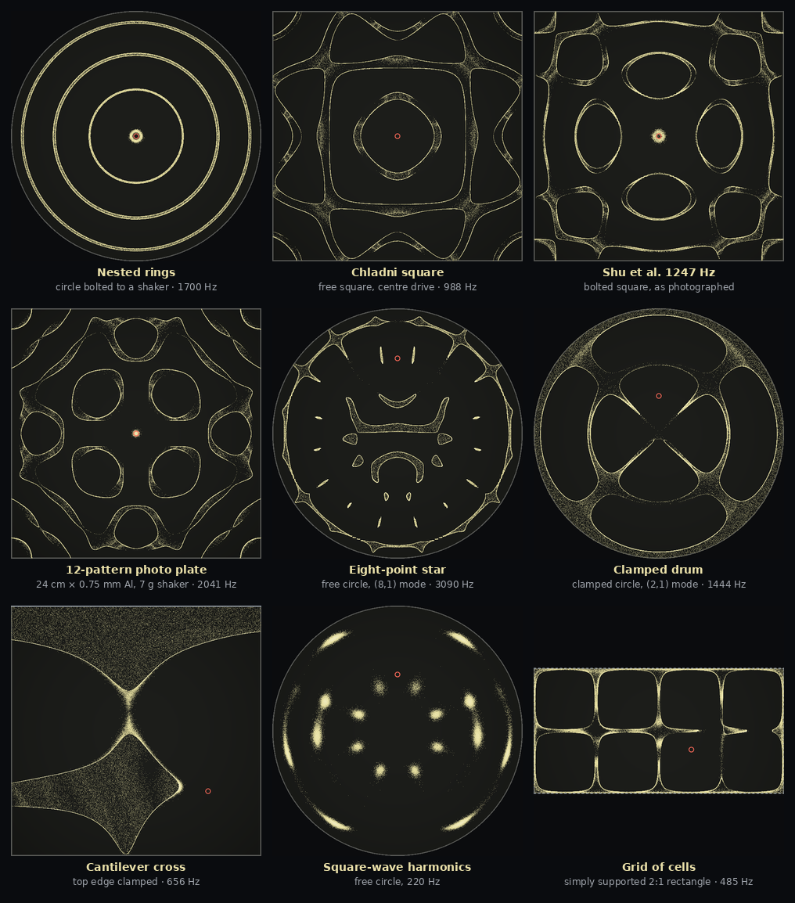

# Cymatix

**See the shape of sound.** Cymatix turns any sound into Chladni figures: sand patterns on a simulated vibrating plate, computed live in your browser from published plate physics.



## Features

- **Three sound sources:** an audio or video file, your microphone, or a test tone (sine, square, sawtooth or triangle).
- **Any plate:** a circle or rectangle of any size and thickness, in aluminium, steel, brass, glass, acrylic or your own material.
- **Real mountings:** free, clamped or simply supported edges, set per edge on rectangles.
- **Three ways to drive it:** a point force, a shaker or a rigid bolt.
- **Nine presets:** including a plate from a [published experiment](https://doi.org/10.3390/e24020215).
- **Mode explorer:** click any natural mode to hear its exact frequency and see its pattern.
- **Nothing to install:** plain JavaScript, no build step and no dependencies.

## Quick start

```bash
git clone https://github.com/dan-garden/cymatix.git
cd cymatix
npm start
```

Then open <http://localhost:8137> and click a preset.

- `npm start` serves the folder with Python 3.
- The microphone only works on `localhost` or HTTPS.
- Click the plate to move the driver.
- **Reset all** restores every default, and so does reloading the page.
- `npm test` runs the physics checks. It needs Node.

## Gallery

Every pattern below is a preset in the app, captured 6 seconds after loading it.



## How it works

1. **Read the sound.** The browser's FFT finds the strongest frequency peaks.
2. **Solve the plate.** The app computes the plate's natural modes from its shape, material and edges.
3. **Shake the plate.** Each peak drives the plate at the driver point. Adding up the modes gives the vibration everywhere.
4. **Move the sand.** Grains only move where the plate accelerates faster than gravity. They drift to quieter spots and collect on the nodal lines.

## The science

Every formula and where it comes from. All the code is in [physics.js](physics.js).

| Part | Model | Source |
|---|---|---|
| Plate bending | Thin-plate theory, `D = Eh³ / 12(1 − ν²)` | [Kirchhoff 1850](https://doi.org/10.1515/crll.1850.40.51), [Leissa 1969](https://ntrs.nasa.gov/citations/19700009156) |
| Circular plates | Exact modes, `[J_n(λρ) + C·I_n(λρ)]·cos nθ` | [Kirchhoff 1850](https://doi.org/10.1515/crll.1850.40.51), [Leissa 1969](https://ntrs.nasa.gov/citations/19700009156) ch. 2 |
| Bessel functions | Integral forms, computed with the trapezoid rule | [DLMF §10.9](https://dlmf.nist.gov/10.9), [DLMF §10.32](https://dlmf.nist.gov/10.32), [Trefethen & Weideman 2014](https://doi.org/10.1137/130932132) |
| Rectangular plates | Rayleigh–Ritz with orthogonal Legendre polynomials, each edge independent | [Ritz 1909](https://doi.org/10.1515/crll.1909.135.1), [Bhat 1985](https://doi.org/10.1016/s0022-460x(85)80109-7), [Dickinson & Di Blasio 1986](https://doi.org/10.1016/s0022-460x(86)80310-8) |
| Eigenvalue solver | Householder tridiagonalisation, then QL | [Martin et al. 1968](https://doi.org/10.1007/bf02161841), [Bowdler et al. 1968](https://doi.org/10.1007/bf02166681), [JAMA](https://math.nist.gov/javanumerics/jama/) |
| Thick plates | Mindlin's dispersion relation for each mode, `κ² = π²/12` | [Mindlin 1951](https://doi.org/10.1115/1.4010217), [Mindlin et al. 1956](https://doi.org/10.1115/1.4011349) |
| Forced vibration | Modal sum with damping, `G(x,x₀) = Σ φ_k(x)·φ_k(x₀) / m(ω_k² − ω² + 2iζω_k·ω)` | [Bishop & Johnson 1960](https://www.cambridge.org/9781107402454) |
| Shaker mount | Force reaching a plate that carries moving mass `m_a`, `F / (1 − m_a·ω²·G₀)`, where `G₀ = G(x₀,x₀)` | Derived here from receptance coupling, [Bishop & Johnson 1960](https://www.cambridge.org/9781107402454) |
| Rigid bolt | The limit of large `m_a`, `W = W₀·G(x,x₀) / G₀` | Same derivation, checked against [Leissa 1969](https://ntrs.nasa.gov/citations/19700009156) Tables 2.12–2.15 |
| Modes above the cut-off | Added to `G₀`: `ln((ω_K+ω)/(ω_K−ω)) / (8πω√(Dρh))` | Derived here from plate modal density, [Cremer et al. 2005](https://doi.org/10.1007/b137728), [Skudrzyk 1980](https://doi.org/10.1121/1.384169) |
| Spectrum | Blackman-window FFT | [W3C Web Audio API](https://www.w3.org/TR/webaudio/), [Harris 1978](https://doi.org/10.1109/proc.1978.10837) |
| Peak finding | Parabolic interpolation between FFT bins | [Smith, *Spectral Audio Signal Processing*](https://ccrma.stanford.edu/~jos/sasp/Quadratic_Interpolation_Spectral_Peaks.html) |
| Several tones | Different frequencies add in power | Modelling choice, no external source |
| Sand threshold | Grains leave the plate when `Γ = acceleration / g > 1` | [Bougie & Duckert 2011](https://doi.org/10.1103/physreve.83.011303) |
| Sand motion | Drift down `∇Γ` plus random scatter | Modelling choice, in line with [Arango & Reyes 2016](https://doi.org/10.1017/s0013091515000139) and [Zhou et al. 2016](https://doi.org/10.1038/ncomms12764) |

## How accurate is it?

`npm test` runs 24 tests. The tables below are the summary. [docs/validation.md](docs/validation.md) has the full results, including errors found in the reference book.

### Against real measurements

| Study | Plate | Compared | Result | In `npm test` |
|---|---|---|---|---|
| [Shu et al. 2022](https://doi.org/10.3390/e24020215) | 320 × 1 mm aluminium square on a shaker | 25 resonances | 1.7 % RMS (chance: 5.5 %) | Yes |
| [Escaler & De La Torre 2018](https://doi.org/10.1016/j.jfluidstructs.2018.07.017) | 240 × 0.8 mm aluminium circle | 6 resonances | −0.4 % to +1.8 %, nothing fitted | Yes |
| [Waller 1938](https://doi.org/10.1088/0959-5309/50/1/306) | Free brass circles | 76 frequency ratios | Median 1.6 % | Yes |
| [Waller 1938](https://doi.org/10.1088/0959-5309/50/1/306) | Free brass circles | 60 nodal circles | Median 0.0014 r/a | Yes |
| [Strehlke 1855](https://doi.org/10.1002/andp.18551710805) | Free circles | Nodal circles | Within 0.003 r/a | Yes |
| [Waller 1939](https://doi.org/10.1088/0959-5309/51/5/312) | Free brass square | 89 frequency ratios | Median 0.9 %, worst 4.4 % | Yes |
| [Leissa 1969](https://ntrs.nasa.gov/citations/19700009156) Tables 4.55–4.58 | Real cantilevers | 68 frequencies | −5.4 % to +2.6 % | Yes |
| [D'Alessio 2021](https://doi.org/10.1007/s42452-020-04062-6) | 240 × 0.9 mm aluminium square | 4–5 resonances | 1.8 % RMS after fitting one factor (chance: 13 %) | No |
| [Kovacic & Kanovic 2023](https://doi.org/10.3390/sym15091748) | 250 × 2 mm square | 4–5 resonances | 1.7 % RMS after fitting one factor (chance: 16 %) | No |
| [Lin et al. 2024](https://doi.org/10.3390/sym16111460) | 320 × 1 mm aluminium square, off-centre drive | Resonances | 3.6 % RMS (chance: 3.3 %), so **inconclusive** | No |

How to read this:

- **"Chance"** is the error a wrong model reaches by accident. A result only means something if it beats chance.
- **Shu et al.:** one value is fitted, the shaker's moving mass (20 g), because the paper doesn't give it. Without any fit, a rigid bolt gives 4.6 % RMS.
- **D'Alessio and Kovacic:** the fitted factor absorbs unknown thickness or stiffness. With so few frequencies, these rows are supporting evidence only.
- **Patterns:** the Shu et al. patterns for f1–f7 were compared with the photos by eye. They match in topology, but this is not a numerical test.

### Against theory

| Reference | Compared | Result |
|---|---|---|
| [Leissa 1969](https://ntrs.nasa.gov/citations/19700009156) ch. 2 and 4 | Every table covering plates the app models | Typical median 0.001 % to 0.2 % |
| Rigorous upper and lower bounds, listed in Leissa | Clamped, cantilever and free rectangles | All inside the bounds |
| [Hashemi & Arsanjani 2005](https://doi.org/10.1016/j.ijsolstr.2004.06.063) | Exact thick-plate solutions | Within 2×10⁻⁵ |
| Exact point-support and point-mass solutions, Leissa Tables 2.12–2.15 | Bolted plate models | Within 0.03 % |
| [Timoshenko & Woinowsky-Krieger 1959](https://archive.org/details/theoryofplatessh0000timo_r3s0) | Static centre deflection of a clamped circle and a simply supported square | Within 0.5 % and 1.5 % |

## Known limits

- **Sand speed is a model.** Where sand ends up follows from the vibration. How fast it gets there uses tuned values for mobility and scatter.
- **Fine powder isn't modelled.** Very fine powder gathers at antinodes because of air currents ([Faraday 1831](https://doi.org/10.1098/rstl.1831.0018)). The app shows sand only.
- **Vibration is linear.** There's no large-amplitude stiffening ([Chu & Herrmann 1956](https://doi.org/10.1115/1.4011396)) and there are no Faraday waves. The app warns above a deflection of 20 % of the thickness, a threshold chosen for this app.
- **Air and sand add no mass.** For 1 mm aluminium, air lowers the fundamental by a few percent and lowers patterns with many nodal lines by under 1 % ([Lamb 1920](https://doi.org/10.1098/rspa.1920.0064), [Kwak & Kim 1991](https://doi.org/10.1016/0022-460x(91)90696-h)). These figures are estimates.
- **The bolt is a point.** A real washer clamps a small disk. This only shows in the nodal circle closest to the clamp.
- **Thick plates are approximate.** Mindlin's correction is exact for simply supported edges only. With other edges at h/a = 0.1, it is still 0.4–5 % off.
- **Free edges differ slightly.** On high-order modes with 5–6 circles, Waller's outermost nodal circle sits 0.012–0.021 r/a further out than thin-plate theory. Every inner circle matches within 0.004.
- **Rectangles have a frequency limit.** Modes are valid up to the frequency shown in the app. A thicker or smaller plate covers higher notes.
- **Your inputs matter most.** A 2 % thickness or stiffness error shifts every resonance by 1–2 %, so measure your plate.
- **Material presets are typical values.** They don't come from one cited source.
- **Quick-pick tones make no health claim.** The Solfeggio, 432 Hz and 440 Hz options are only convenient frequencies. The pattern depends on the plate, not on any special frequency.

## Project files

- [index.html](index.html): the page and its controls.
- [app.js](app.js): audio, sand and drawing.
- [physics.js](physics.js): all the plate maths.
- `*.test.js`: the checks against theory, measurements and Leissa's book.

## References

### Plate theory

- Kirchhoff (1850). [Über das Gleichgewicht und die Bewegung einer elastischen Scheibe](https://doi.org/10.1515/crll.1850.40.51). *J. reine angew. Math.* 40, 51–88.
- Rayleigh (1894). [The Theory of Sound, vol. 1, 2nd ed.](https://archive.org/details/theorysound07raylgoog) Macmillan.
- Ritz (1909). [Über eine neue Methode zur Lösung gewisser Variationsprobleme der mathematischen Physik](https://doi.org/10.1515/crll.1909.135.1). *J. reine angew. Math.* 135, 1–61.
- Lamb (1920). [On the vibrations of an elastic plate in contact with water](https://doi.org/10.1098/rspa.1920.0064). *Proc. R. Soc. A* 98, 205–216.
- Mindlin (1951). [Influence of rotatory inertia and shear on flexural motions of isotropic, elastic plates](https://doi.org/10.1115/1.4010217). *J. Appl. Mech.* 18, 31–38.
- Mindlin, Schacknow & Deresiewicz (1956). [Flexural vibrations of rectangular plates](https://doi.org/10.1115/1.4011349). *J. Appl. Mech.* 23, 430–436.
- Chu & Herrmann (1956). [Influence of large amplitudes on free flexural vibrations of rectangular elastic plates](https://doi.org/10.1115/1.4011396). *J. Appl. Mech.* 23, 532–540.
- Timoshenko & Woinowsky-Krieger (1959). [Theory of Plates and Shells, 2nd ed.](https://archive.org/details/theoryofplatessh0000timo_r3s0) McGraw-Hill.
- Bishop & Johnson (1960). [The Mechanics of Vibration](https://www.cambridge.org/9781107402454). Cambridge University Press.
- Leissa (1969). [Vibration of Plates, NASA SP-160](https://ntrs.nasa.gov/citations/19700009156). Also as a [full scan](https://archive.org/details/DTIC_ADA307623).
- Skudrzyk (1980). [The mean-value method of predicting the dynamic response of complex vibrators](https://doi.org/10.1121/1.384169). *J. Acoust. Soc. Am.* 67, 1105–1135.
- Bhat (1985). [Natural frequencies of rectangular plates using characteristic orthogonal polynomials in Rayleigh-Ritz method](https://doi.org/10.1016/s0022-460x(85)80109-7). *J. Sound Vib.* 102, 493–499.
- Dickinson & Di Blasio (1986). [On the use of orthogonal polynomials in the Rayleigh-Ritz method for the study of the flexural vibration and buckling of isotropic and orthotropic rectangular plates](https://doi.org/10.1016/s0022-460x(86)80310-8). *J. Sound Vib.* 108, 51–62.
- Kwak & Kim (1991). [Axisymmetric vibration of circular plates in contact with fluid](https://doi.org/10.1016/0022-460x(91)90696-h). *J. Sound Vib.* 146, 381–389.
- Hashemi & Arsanjani (2005). [Exact characteristic equations for some of classical boundary conditions of vibrating moderately thick rectangular plates](https://doi.org/10.1016/j.ijsolstr.2004.06.063). *Int. J. Solids Struct.* 42, 819–853.
- Cremer, Heckl & Petersson (2005). [Structure-Borne Sound, 3rd ed.](https://doi.org/10.1007/b137728) Springer.

### Experiments

- Chladni (1787). [Entdeckungen über die Theorie des Klanges](https://www.digitale-sammlungen.de/en/view/bsb10908815). Weidmanns Erben und Reich.
- Strehlke (1855). [Ueber die Schwingungen homogener elastischer Scheiben](https://doi.org/10.1002/andp.18551710805). *Ann. Phys.* 171, 577–602. The radii are quoted in Rayleigh §220.
- Waller (1938). [Vibrations of free circular plates. Part 1: Normal modes](https://doi.org/10.1088/0959-5309/50/1/306). *Proc. Phys. Soc.* 50, 70–76. Leissa Ref. 2.21.
- Waller (1939). [Vibrations of free square plates: part I. Normal vibrating modes](https://doi.org/10.1088/0959-5309/51/5/312). *Proc. Phys. Soc.* 51, 831–844. Leissa Ref. 4.119.
- Escaler & De La Torre (2018). [Axisymmetric vibrations of a circular Chladni plate in air and fully submerged in water](https://doi.org/10.1016/j.jfluidstructs.2018.07.017). *J. Fluids Struct.* 82, 432–445.
- D'Alessio (2021). [Forced free vibrations of a square plate](https://doi.org/10.1007/s42452-020-04062-6). *SN Appl. Sci.* 3, 60.
- Shu, Tseng, Lai, Yu, Huang & Chen (2022). [Exploring the origin of maximum entropy states relevant to resonant modes in modern Chladni plates](https://doi.org/10.3390/e24020215). *Entropy* 24, 215.
- Kovacic & Kanovic (2023). [Chladni plate in anechoic chamber: symmetry in vibrational and acoustic response](https://doi.org/10.3390/sym15091748). *Symmetry* 15, 1748.
- Lin, Hsu, Su, Liang & Chen (2024). [Exploring the multiplication of resonant modes in off-center-driven Chladni plates from maximum entropy states](https://doi.org/10.3390/sym16111460). *Symmetry* 16, 1460.

### Sand and granular motion

- Faraday (1831). [On a peculiar class of acoustical figures, and on certain forms assumed by groups of particles upon vibrating elastic surfaces](https://doi.org/10.1098/rstl.1831.0018). *Phil. Trans. R. Soc.* 121, 299–340.
- Bougie & Duckert (2011). [Continuum simulations of shocks and patterns in vertically oscillated granular layers](https://doi.org/10.1103/physreve.83.011303). *Phys. Rev. E* 83, 011303. [Free copy on arXiv](https://arxiv.org/abs/1009.2742).
- Arango & Reyes (2016). [Stochastic models for Chladni figures](https://doi.org/10.1017/s0013091515000139). *Proc. Edinb. Math. Soc.* 59, 287–300.
- Zhou, Sariola, Latifi & Liimatainen (2016). [Controlling the motion of multiple objects on a Chladni plate](https://doi.org/10.1038/ncomms12764). *Nat. Commun.* 7, 12764.

### Numerics and signal processing

- Martin, Reinsch & Wilkinson (1968). [Householder's tridiagonalization of a symmetric matrix](https://doi.org/10.1007/bf02161841). *Numer. Math.* 11, 181–195.
- Bowdler, Martin, Reinsch & Wilkinson (1968). [The QR and QL algorithms for symmetric matrices](https://doi.org/10.1007/bf02166681). *Numer. Math.* 11, 293–306.
- Harris (1978). [On the use of windows for harmonic analysis with the discrete Fourier transform](https://doi.org/10.1109/proc.1978.10837). *Proc. IEEE* 66, 51–83.
- Trefethen & Weideman (2014). [The exponentially convergent trapezoidal rule](https://doi.org/10.1137/130932132). *SIAM Rev.* 56, 385–458.
- Hicklin, Moler, Webb et al. [JAMA: A Java Matrix Package](https://math.nist.gov/javanumerics/jama/). NIST and MathWorks.
- NIST. [Digital Library of Mathematical Functions, §10.9](https://dlmf.nist.gov/10.9) and [§10.32](https://dlmf.nist.gov/10.32).
- Smith. [Quadratic interpolation of spectral peaks](https://ccrma.stanford.edu/~jos/sasp/Quadratic_Interpolation_Spectral_Peaks.html), in *Spectral Audio Signal Processing*.
- W3C. [Web Audio API](https://www.w3.org/TR/webaudio/).

### Data read through Leissa's book

These values were read from [Leissa 1969](https://ntrs.nasa.gov/citations/19700009156), not from the originals. "Ref." is the reference number in the book. Reports with no online copy link to the book's listing.

<details>
<summary>Show all 21 sources</summary>

- Lemke (1928). [Experimentelle Untersuchungen zur W. Ritzschen Theorie der Transversalschwingungen quadratischer Platten](https://doi.org/10.1002/andp.19283911304). *Ann. Phys.* 391, 717–750. Ref. 4.110.
- Iguchi (1938). Die Eigenwertprobleme für die elastische rechteckige Platte. *Mem. Fac. Eng., Hokkaido Univ.*, 305–372. [Ref. 4.9](https://archive.org/details/DTIC_ADA307623).
- Aronszajn (1950). The Rayleigh-Ritz and the Weinstein methods for approximation of eigenvalues, part III. Tech. Rept. 3, Oklahoma A&M College. [Ref. 4.49](https://archive.org/details/DTIC_ADA307623).
- Young (1950). [Vibration of rectangular plates by the Ritz method](https://doi.org/10.1115/1.4010175). *J. Appl. Mech.* 17, 448–453. Ref. 4.47.
- Barton (1951). [Vibration of rectangular and skew cantilever plates](https://doi.org/10.1115/1.4010265). *J. Appl. Mech.* 18, 129–134. Ref. 4.73.
- Kanazawa & Kawai (1952). On the lateral vibration of anisotropic rectangular plates. *Proc. 2nd Jap. Natl. Congr. Appl. Mech.*, 333–338. [Ref. 4.16](https://archive.org/details/DTIC_ADA307623).
- Iguchi (1953). [Die Eigenschwingungen und Klangfiguren der vierseitig freien rechteckigen Platte](https://doi.org/10.1007/bf00535853). *Ingenieur-Archiv* 21, 303–322. Ref. 4.113.
- Wilson & Plunkett (1953). Vibration of cantilever plates with rectangular and wedge-shaped cross-sections. Report DF 53GL17, General Electric. [Ref. 4.85](https://archive.org/details/DTIC_ADA307623).
- Gustafson, Stokey & Zorowski (1954). [The effect of tip removal on the natural vibrations of uniform cantilevered triangular plates](https://doi.org/10.2514/8.3148). *J. Aeronaut. Sci.* 21, 621–633. Ref. 4.87.
- Heiba (1954). Vibration characteristics of a cantilever plate with sweptback leading edge. Report 82, Cranfield College of Aeronautics. [Ref. 4.83](https://archive.org/details/DTIC_ADA307623).
- Ödman (1955). Studies of boundary value problems, part II: characteristic functions of rectangular plates. Proc. NR 24, Swedish Cement and Concrete Research Institute. [Ref. 4.13](https://archive.org/details/DTIC_ADA307623).
- Dill & Pister (1958). Vibration of rectangular plates and plate systems. *Proc. 3rd U.S. Natl. Congr. Appl. Mech.*, 123–132. [Ref. 4.24](https://archive.org/details/DTIC_ADA307623).
- Gontkevich (1960). The lower bounds of natural frequencies of a plate in flexural vibrations. *Prikl. Mekh.* 6, 346–350. [Ref. 4.55](https://archive.org/details/DTIC_ADA307623).
- Claassen & Thorne (1961). [Vibrations of thin rectangular isotropic plates](https://doi.org/10.1115/1.3641676). *J. Appl. Mech.* 28, 304–305. Refs. 4.35 and 4.36.
- Plunkett (1963). [Natural frequencies of uniform and non-uniform rectangular cantilever plates](https://doi.org/10.1243/jmes_jour_1963_005_020_02). *J. Mech. Eng. Sci.* 5, 146–156. Ref. 4.84.
- Craig, Plass & Caughfield (1964). Experimental determination of frequencies and mode shapes of cantilever and hub-pin plates. Report DRL-518, University of Texas. [Ref. 4.86](https://archive.org/details/DTIC_ADA307623).
- Gontkevich (1964). Natural Vibrations of Plates and Shells. Naukova Dumka. [Ref. 4.51](https://archive.org/details/DTIC_ADA307623).
- Bazley, Fox & Stadter (1965). Upper and lower bounds for frequencies of rectangular cantilever plates. Tech. Memo TG-705, Johns Hopkins APL. [Ref. 4.75](https://archive.org/details/DTIC_ADA307623).
- Sigillito (1965). Improved upper bounds for frequencies of rectangular free and cantilever plates. Eng. Memo EM-4012, Johns Hopkins APL. [Ref. 4.76](https://archive.org/details/DTIC_ADA307623).
- Bazley, Fox & Stadter (1967). [Upper and lower bounds for the frequencies of rectangular clamped plates](https://doi.org/10.1002/zamm.19670470307). *ZAMM* 47, 191–198. Journal version of Ref. 4.58.
- Bazley, Fox & Stadter (1967). [Upper and lower bounds for the frequencies of rectangular free plates](https://doi.org/10.1007/bf01601716). *ZAMP* 18, 445–460. Journal version of Ref. 4.118.

</details>
